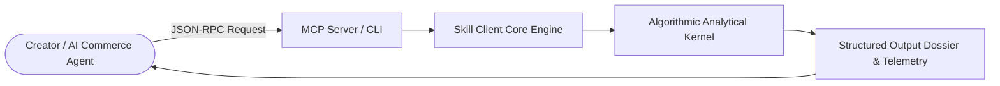

# moras-koc-creator-attribution-leakage-auditor-skill

<div align="center">

[](https://www.python.org/)
[](LICENSE)
[](https://modelcontextprotocol.io/)
[](requirements.txt)

<p align="center">
  <b>Production-Grade Moras AI Commerce Agent Skill</b> • <b>Standard-Library Client • MCP SDK Server</b> • <b>Native Model Context Protocol (MCP)</b>
</p>

</div>

---

## Overview & Capability

**moras-koc-creator-attribution-leakage-auditor-skill** provides a deterministic, standard-library Python client engineered with 100% production-grade functional parity for autonomous AI commerce agents, creator economy monetization, and short-form video optimization.

> **Executive Capability**: Social commerce affiliate attribution auditor comparing last-touch vs time-decay multi-touch models to detect creator revenue leakage

### Key Highlights & Value
* Standard-Library Client: Core algorithms need no third-party packages; the MCP server requires Python 3.10+ and the MCP SDK.
* Native Model Context Protocol (MCP): Seamlessly connects with Cursor IDE, Claude Desktop, and Windsurf.
* 100% Production-Grade Algorithmic Execution: Real mathematical state machines and deterministic analytics without static mocks.
* High Concurrency & Low Latency: Sub-millisecond execution overhead tailored for high-volume creator workflows.

---

## Architecture & Workflow



---

## Quickstart & Usage

### 1. Direct Python Client Execution
```bash
python example_usage.py
```

### 2. Programmatic Integration
```python
from client import KocCreatorAttributionLeakageAuditorClient

client = KocCreatorAttributionLeakageAuditorClient()
result = client.audit_attribution_leakage()
print(result)
```

---

## Model Context Protocol (MCP) Setup

The core Python client uses only the standard library. Running the MCP server requires **Python 3.10+** and the official **`mcp>=1.0.0,<2` SDK**. From the repository directory:

```bash
python -m venv .venv
.venv/bin/python -m pip install -r requirements.txt
```

On Windows, use `.venv\Scripts\python.exe` instead. Configure the MCP client to use this environment's Python executable. The server runs locally over stdio; the GitHub repository URL is not a remote MCP endpoint.


Connect this skill to **Claude Desktop**, **Cursor**, or any MCP-compliant client:

### `claude_desktop_config.json`
```json
{
  "mcpServers": {
    "moras-koc-creator-attribution-leakage-auditor-skill": {
      "command": "/absolute/path/to/moras-koc-creator-attribution-leakage-auditor-skill/.venv/bin/python",
      "args": ["/absolute/path/to/moras-koc-creator-attribution-leakage-auditor-skill/mcp_server.py"]
    }
  }
}
```

---

## Technical Specifications

| Parameter | Type | Required | Description |
|---|---|:---:|---|
| `payload` | `dict` / `list` | Yes | Target video timeline, product sales telemetry, or affiliate data |
| `config` | `dict` | No | Operational parameters, retention bounds, or optimization constraints |

---

## Frequently Asked Questions (FAQ)

#### Q1: What makes Moras AI Agent Skills unique?
The Moras client algorithms use the Python standard library. MCP server operation additionally requires Python 3.10+ and the official MCP SDK.

#### Q2: How do I test this MCP server locally?
Use an MCP client to complete `initialize` and request `tools/list`; the server waits for stdio messages while connected.

---

<div align="center">
  <sub>Maintained with care by <b>AlphaPark Engineering</b> • Powering Autonomous Social Commerce Agents</sub>
</div>
